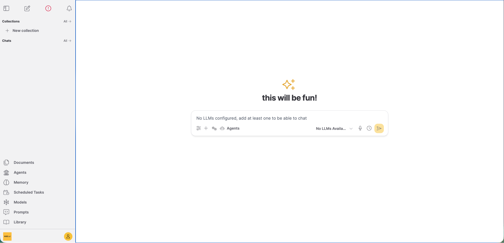
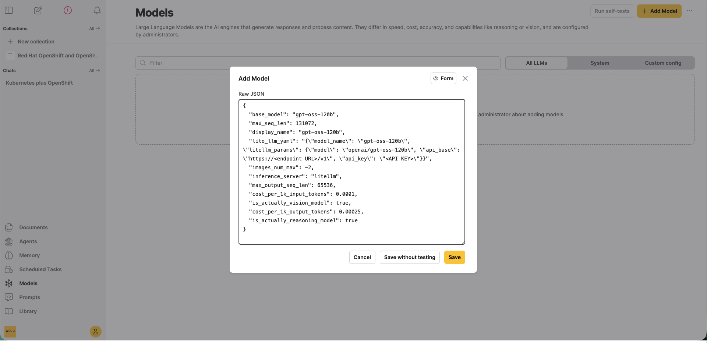
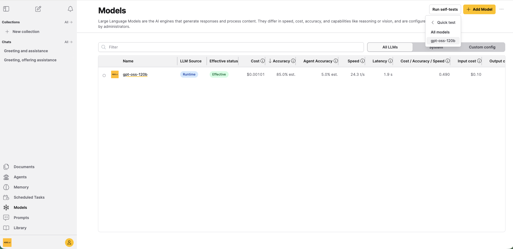
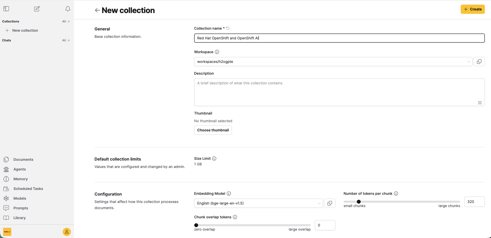
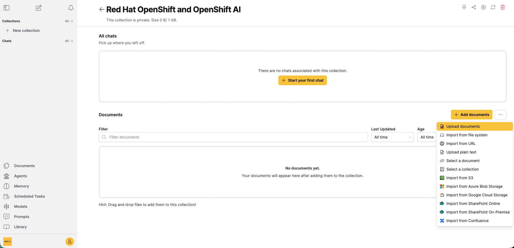
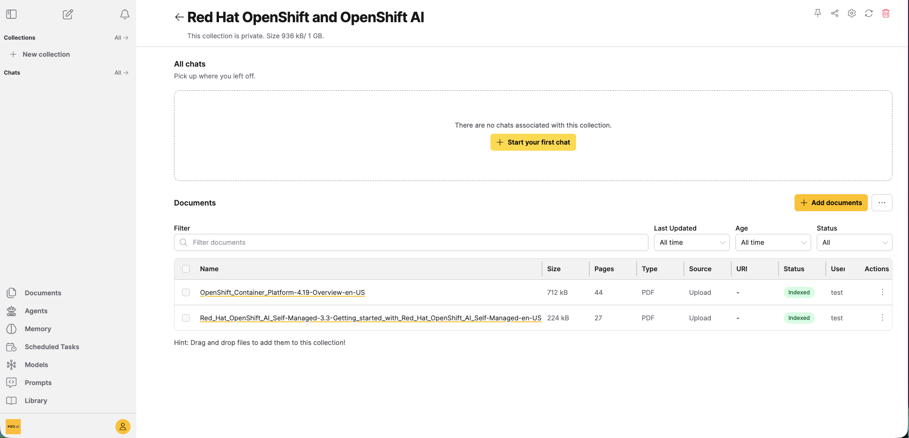
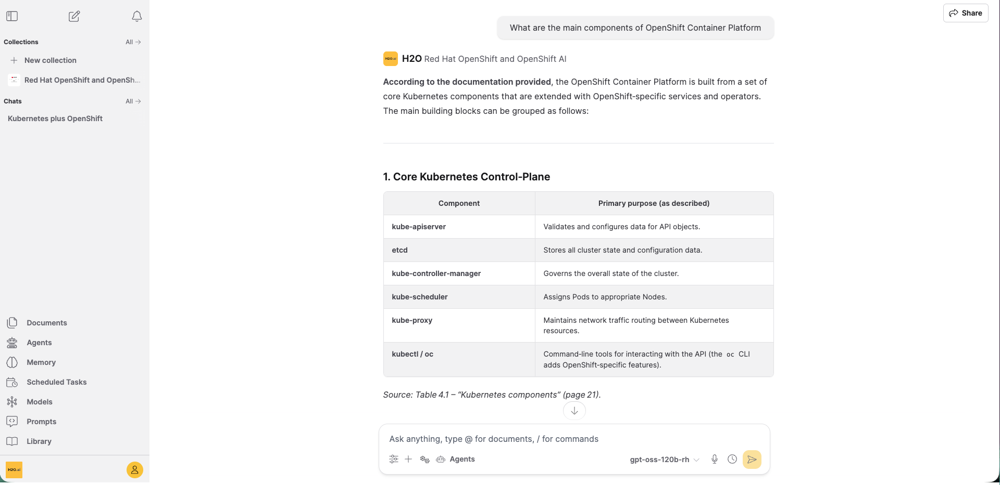
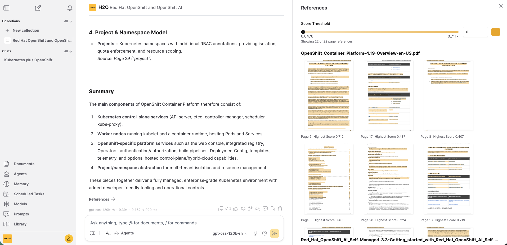
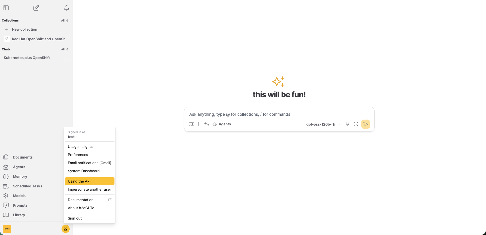

# Build AI knowledge management with H2O.ai and OpenShift AI

Turn company documents into a private knowledge base with cited AI answers, using H2O Enterprise h2oGPTe on OpenShift and a model served by OpenShift AI.

## Table of contents

- [Detailed description](#detailed-description)
  - [Who is this for?](#who-is-this-for)
  - [The business case for AI knowledge management](#the-business-case-for-ai-knowledge-management)
  - [What this quickstart provides](#what-this-quickstart-provides)
  - [Model options](#model-options)
  - [What you'll build](#what-youll-build)
  - [Architecture](#architecture)
- [Requirements](#requirements)
  - [Minimum hardware requirements](#minimum-hardware-requirements)
  - [Minimum software requirements](#minimum-software-requirements)
  - [Required user permissions](#required-user-permissions)
- [Deploy](#deploy)
  - [Prerequisites](#prerequisites)
  - [Clone the repository](#clone-the-repository)
  - [Configure the installation](#configure-the-installation)
  - [Install](#install)
  - [Verify and log in](#verify-and-log-in)
  - [Connect a model](#connect-a-model)
  - [Load the sample documents](#load-the-sample-documents)
  - [Walk through the application](#walk-through-the-application)
  - [What you've accomplished](#what-youve-accomplished)
  - [Delete](#delete)
- [Troubleshooting](#troubleshooting)
- [References](#references)
- [Where to get help](#where-to-get-help)
- [Tags](#tags)

## Detailed description

Enterprise knowledge is spread across policies, manuals, contracts, and reports that few people have time to read. This quickstart deploys H2O Enterprise h2oGPTe on Red Hat OpenShift as a private knowledge management platform. In the recommended setup, Red Hat OpenShift AI serves the large language model (LLM) that h2oGPTe uses to generate answers. Users add documents to collections and ask questions in plain language. h2oGPTe answers from the content of those documents and cites the source passages, so every answer can be checked.

With the model on the cluster, everything runs on your own OpenShift cluster: the h2oGPTe application with its document processing and search services, and the model server. OpenShift AI is an operator on the same cluster. In this quickstart, it only serves the model with vLLM; h2oGPTe itself is installed with Helm and doesn't depend on it. Documents and questions never leave the cluster.

The installation script deploys h2oGPTe and can optionally deploy gpt-oss-20b on OpenShift AI with Helm. You then add the model in the h2oGPTe UI. Finally, you create a collection in the h2oGPTe UI and upload the sample documents to it.

### Who is this for?

This quickstart is for:

- **Knowledge workers and business teams** who need fast, trustworthy answers from large document collections
- **Solution architects** evaluating a private retrieval-augmented generation (RAG) platform on OpenShift
- **Platform and DevOps engineers** deploying an enterprise AI application with Helm on OpenShift
- **Teams exploring the Red Hat AI quickstart catalog** who want a complete, working example with a partner product

### The business case for AI knowledge management

Employees spend a large part of their week searching for information. The answers usually exist, but they are buried in long documents across many systems, and keyword search returns documents rather than answers.

Public AI assistants can summarize and answer questions, but many organizations cannot send internal documents to an external service because of privacy, regulatory, or intellectual property concerns. Answers without sources are also hard to trust for decisions.

A private knowledge base addresses both problems. Documents stay inside the organization's infrastructure, and every answer links back to the passages it came from. Teams can build collections per department or project, and the same platform serves both a chat UI and an API for integration with other applications.

### What this quickstart provides

This quickstart provides:

- An installation script that deploys H2O Enterprise h2oGPTe from the H2O AI Cloud Helm chart
- An optional Helm chart to deploy RedHatAI/gpt-oss-20b with vLLM on OpenShift AI, plus instructions to connect it or an external endpoint in the h2oGPTe UI
- Sample documents from the Red Hat OpenShift and OpenShift AI documentation, to upload to an h2oGPTe collection

The h2oGPTe container images and license are provided by H2O.ai (see [Prerequisites](#prerequisites)).

### Model options

h2oGPTe works with any LLM that has an OpenAI-compatible API. This quickstart supports two options:

- **Model on the cluster (recommended):** run `make install INSTALL_MODEL=true` to deploy RedHatAI/gpt-oss-20b with vLLM on OpenShift AI. This keeps all data on the cluster, and needs one more GPU and OpenShift AI.
- **External model endpoint:** h2oGPTe uses an existing OpenAI-compatible endpoint, such as [Models-as-a-Service (MaaS)](https://docs.redhat.com/en/documentation/red_hat_openshift_ai_self-managed/3.5/html/govern_llm_access_with_models-as-a-service/index) in Red Hat OpenShift AI, or a model service that your organization already runs. No GPU or OpenShift AI is needed for the model. The relevant document passages and the questions are sent to that endpoint.

With either option, you add the model in the h2oGPTe UI after installation. See [Connect a model](#connect-a-model).

### What you'll build

Time to complete: about 60–90 minutes, most of it waiting for downloads. The installation script takes a few minutes when the container images are already on the nodes, and up to 30 minutes or more on a new cluster, because the h2oGPTe GPU images are about 100 GB in total. Deploying the model on OpenShift AI also downloads the model.

By the end of this quickstart, you will have:

- h2oGPTe running on OpenShift, with its document processing, search, and chat services
- An LLM served through vLLM on Red Hat OpenShift AI (or an external endpoint), connected to h2oGPTe
- A ready-to-use collection of sample documents, processed and indexed for search
- Answers to questions about those documents, with citations to the source passages
- An understanding of how to add your own documents and how to connect other models

#### Key technologies

- **[H2O Enterprise h2oGPTe](https://h2o.ai/platform/enterprise-h2ogpte/)**: enterprise RAG platform for document ingestion, search, and question answering with citations
- **[Red Hat OpenShift AI](https://www.redhat.com/en/products/ai/openshift-ai) (KServe)**: serves the LLM on the cluster
- **[vLLM](https://github.com/vllm-project/vllm)**: high-throughput inference engine that serves the model
- **[gpt-oss-20b](https://huggingface.co/RedHatAI/gpt-oss-20b)**: the default open-weight model (Apache 2.0, not gated)
- **[Models-as-a-Service (MaaS)](https://docs.redhat.com/en/documentation/red_hat_openshift_ai_self-managed/3.5/html/govern_llm_access_with_models-as-a-service/index)**: optional external model endpoint, instead of the model on the cluster
- **[NVIDIA GPU Operator](https://docs.nvidia.com/datacenter/cloud-native/gpu-operator/latest/index.html)**: makes the GPUs available to h2oGPTe and the model server
- **[Keycloak](https://www.keycloak.org/)**: user login for h2oGPTe
- **[PostgreSQL](https://www.postgresql.org/)**, **[MinIO](https://min.io/)**, and **[Redis](https://redis.io/)**: document metadata, document storage, and caching, included with h2oGPTe
- **[Helm](https://helm.sh/)**: packaging and deployment

### Architecture


| Layer | Component | Purpose |
| --- | --- | --- |
| **Access** | OpenShift Routes | Expose h2oGPTe and Keycloak to users over TLS |
| **Knowledge management** | H2O Enterprise h2oGPTe (2 GPUs) | Web UI and API, collections and chat, document processing and OCR, embeddings, and search. Its model router sends each prompt to the configured LLM. |
| **Identity** | Keycloak (included with h2oGPTe) | User login for h2oGPTe |
| **Data services** | PostgreSQL, MinIO, Redis (included with h2oGPTe) | Metadata, document storage, and caching |
| **Vector database** | [VEX](https://docs.h2o.ai/enterprise-h2ogpte/architecture/vector-database) (included with h2oGPTe) | Stores the document passages and their embeddings for search |
| **Model inference** | vLLM on KServe with an open LLM (1 GPU; gpt-oss-20b in this quickstart), in the same namespace as h2oGPTe | Serves the LLM through an OpenAI-compatible API |
| **External model (optional)** | An OpenAI-compatible endpoint, for example MaaS | Replaces the model on the cluster |
| **Cluster operators** | Red Hat OpenShift AI, NVIDIA GPU Operator, Node Feature Discovery | OpenShift AI serves the model on the cluster. The GPU Operator provides the GPU drivers and device plugin. Node Feature Discovery labels the GPU nodes for the GPU Operator. |

When a user adds a document, h2oGPTe stores it, extracts its text (with OCR for scanned pages), splits it into passages, and indexes their embeddings. When a user asks a question, h2oGPTe retrieves the most relevant passages and sends them with the question to the model. The model's answer is returned with citations to those passages.

## Requirements

### Minimum hardware requirements

The following resources are needed in addition to the OpenShift control plane nodes.

| Node type | Count | Size per node | Used by |
| --- | --- | --- | --- |
| CPU worker | 3 | 8 vCPU, 32 GiB memory, 200 GiB disk | h2oGPTe services, data services, OpenShift AI |
| GPU worker | 2 + 1 | 8 vCPU, 96 GiB memory, 200 GiB disk, 1 NVIDIA GPU with at least 40 GB memory | 2 for h2oGPTe, plus 1 for the model on the cluster |

GPU notes:

- Use NVIDIA data center GPUs with at least 40 GB memory that the NVIDIA GPU Operator supports, for example the RTX PRO 6000 Blackwell Server Edition (96 GB), L40S (48 GB), A100 (40 GB or 80 GB), or H100 (80 GB).
- With an external model endpoint, the third GPU worker is not needed.
- The default Helm values use two full GPUs for h2oGPTe. To use one RTX PRO 6000 Blackwell 96 GB GPU split into two `2g.48gb` MIG instances instead, follow the [GPU and MIG setup guide](docs/gpu-mig-setup.md) before installing. The guide covers the cluster configuration and the two GPU resource names to change in the values template. A model served on OpenShift AI still needs separate GPU capacity; an external model endpoint does not.

### Minimum software requirements

**Local tools:**

- [oc CLI](https://docs.redhat.com/en/documentation/openshift_container_platform/4.22/html/cli_tools/openshift-cli-oc) 4.20 or later
- [Helm](https://helm.sh/docs/intro/install/) 3.19 or later
- [git](https://git-scm.com/downloads)
- Bash 3.2 or later, on Linux or macOS. The scripts run with Bash, so you can start them from any shell, such as zsh.

**Cluster environment:**

| Component | Version |
| --- | --- |
| Red Hat OpenShift | 4.20 to 4.22 |
| Red Hat OpenShift AI | 3.5, with the KServe component enabled. Only needed for the model on the cluster. |
| NVIDIA GPU Operator | 26.7 |
| Node Feature Discovery Operator | 4.22. Required by the NVIDIA GPU Operator. |

- A default StorageClass. Clusters on a cloud provider usually have one. On bare metal, install [OpenShift Data Foundation](https://docs.redhat.com/en/documentation/red_hat_openshift_data_foundation) or the [LVM Storage Operator](https://docs.redhat.com/en/documentation/openshift_container_platform/4.22/html/storage/persistent-storage-using-local-storage#persistent-storage-using-lvms).

### Required user permissions

- `cluster-admin`

Cluster administrator access is required because the installation creates a namespace and a ClusterRole and ClusterRoleBinding for h2oGPTe, and copies the default ingress certificate from the `openshift-ingress` namespace.

## Deploy

### Prerequisites

Before you install, make sure you have the following:

1. **An H2O trial license and registry credentials.** Email [sales@h2o.ai](mailto:sales@h2o.ai) and ask for an h2oGPTe trial for this quickstart. You receive:
   - An h2oGPTe license key
   - A username and access token for the H2O container registry
2. **An OpenShift cluster** that meets the [hardware](#minimum-hardware-requirements) and [software](#minimum-software-requirements) requirements, with the Node Feature Discovery Operator and the NVIDIA GPU Operator installed. OpenShift AI is also needed for the model on the cluster. If you use an external model endpoint instead, you need its URL, model ID, and API key.
3. **Access to the cluster as a cluster administrator:**
   ```bash
      oc whoami
      oc get nodes
   ```
4. **Network access** to Docker Hub, from your workstation (H2O Helm chart) and from the cluster (H2O images). For the optional model, the cluster also needs access to `registry.redhat.io` (vLLM runtime and modelcar), with valid Red Hat registry pull credentials. An external model requires network access to its endpoint.

This quickstart uses the cluster's default application domain (`*.apps.<cluster-domain>`) and its default certificate, so you don't need to create DNS records or certificates.

### Clone the repository

```bash
git clone https://github.com/rh-ai-quickstart/h2o-knowledge-mgmt.git
cd h2o-knowledge-mgmt
```

### Configure the installation

Copy the example settings file and add your H2O credentials:

```bash
cp .env.example .env
```

Edit `.env`. All H2O variables must be set; the installation script stops if one is missing. `.env.example` contains the default values.

| Variable | Description | Default in `.env.example` |
| --- | --- | --- |
| `H2O_REGISTRY` | Registry that hosts the h2oGPTe images and Helm chart | `docker.io/h2oairelease` |
| `H2O_REGISTRY_USERNAME`, `H2O_REGISTRY_TOKEN` | Credentials for the H2O registry, from your trial email | Empty: you must set them |
| `H2OGPTE_LICENSE` | h2oGPTe license key, from your trial email | Empty: you must set it |
| `H2O_CHART_VERSION` | Version of the H2O AI Cloud Helm chart that installs h2oGPTe | `5.2.1` |
| `NAMESPACE` | Namespace for h2oGPTe | `h2o-knowledge-mgmt` |
| `KEYCLOAK_ADMIN_PASSWORD` | Password of the Keycloak administrator | A test password |
| `H2OGPTE_ADMIN_PASSWORD` | Password of the h2oGPTe admin user `test` that the installation creates | A test password |

The default passwords are for testing only. Set your own passwords if other people can reach the h2oGPTe URL.

`.env` is excluded from Git. Don't commit it, because it contains your credentials.

### Install

Run the installation script through Make:

```bash
make deploy
```

To also deploy the model, run:

```bash
make deploy INSTALL_MODEL=true
```

Without `INSTALL_MODEL=true`, installation only deploys h2oGPTe. All commands read the repository-root `.env` as Bash variables.

The script prints each step as it runs:

| Step | What it does |
| --- | --- |
| 0 | Checks that `oc` and `helm` are installed and that you're logged in, and shows the cluster that it will change. |
| 1 | Creates the namespace `NAMESPACE`. |
| 2 | Copies the cluster's default ingress certificate into the namespace as the secret `h2oai-tls`. |
| 3 | Creates the image pull secret `h2oai-registry` for the H2O registry. |
| 4 | Creates the license secret `h2oai-h2ogpte-license`. |
| 5 | Creates the Keycloak administrator secret `h2oai-keycloak-admin-user`. |
| 6 | Generates `deploy/helm/values.yaml` from the template `deploy/helm/values.<H2O_CHART_VERSION>.yaml.tmp`, with your cluster's domain and registry. |
| 7 | Downloads the H2O AI Cloud Helm chart and installs h2oGPTe with it (Helm release `h2oai`). |
| 8 | Waits until all pods are running or completed. The first installation downloads large images; if the wait times out after 30 minutes, run the script again. |
| 9 | Creates the h2oGPTe admin user `test` in Keycloak, with the password from `H2OGPTE_ADMIN_PASSWORD` and the realm roles `admin` and `full_access`. |
| 10 | Prints the h2oGPTe and Keycloak URLs and usernames. |

When the script finishes, it prints the URLs and usernames. The passwords are the ones you set in `.env`:

```text
==> Step 10: done
h2oGPTe
  URL:      https://h2ogpte.apps.<cluster-domain>
  Username: test
  Password: H2OGPTE_ADMIN_PASSWORD in .env

Keycloak administration console
  URL:      https://auth.apps.<cluster-domain>/auth/admin/
  Username: admin
  Password: KEYCLOAK_ADMIN_PASSWORD in .env

Next: connect a model and load the sample documents (see README.md).
```

With `INSTALL_MODEL=true`, the script installs the model Helm release after h2oGPTe setup. You still register the model in the h2oGPTe UI and upload documents as described in [Connect a model](#connect-a-model) and [Load the sample documents](#load-the-sample-documents).

The script is safe to run again. Steps that are already complete don't change anything.

The Helm values template tolerates the GPU node taint `nvidia.com/gpu=true:NoSchedule`. If your GPU nodes use a different taint, change the toleration under `global.profiles` in `deploy/helm/values.<H2O_CHART_VERSION>.yaml.tmp` before you run the script.

### Verify and log in

Open the h2oGPTe URL that the script printed, and log in as `test` with the password from `H2OGPTE_ADMIN_PASSWORD` in `.env`.

After you log in, h2oGPTe shows its home page. The chat box says **No LLMs configured** until you [connect a model](#connect-a-model):



The admin user is for this quickstart only. For other users, create accounts in Keycloak or connect Keycloak to your identity provider.

### Connect a model

h2oGPTe needs an LLM to answer questions. Connect one with either option below. Both end with the same step: [add the model in h2oGPTe](#add-the-model-in-h2ogpte).

#### Option 1: deploy the model on OpenShift AI (recommended)

If you used `INSTALL_MODEL=true`, the model resources are already installed. To install or upgrade the model separately, run:

```bash
make model-install
```

This target uses `NAMESPACE` from `.env` and installs the model in the same namespace as h2oGPTe. The endpoint is internal and has no token authentication; use network policies to limit access to trusted workloads.

The chart deploys [RedHatAI/gpt-oss-20b](https://huggingface.co/RedHatAI/gpt-oss-20b) with vLLM and needs one additional NVIDIA GPU. OpenShift AI must have KServe and OCI modelcar support enabled. Model settings live in `deploy/helm/model/values.yaml`. If your GPU nodes have a custom taint, add the matching toleration under `tolerations` in that file before deploying.

Helm submits the resources but does not wait for the model to become ready. Before connecting h2oGPTe, wait for readiness with:

```bash
oc wait --for=condition=Ready inferenceservice/h2oai-model \
  -n h2o-knowledge-mgmt --timeout=30m
```

Replace the namespace if you changed `NAMESPACE`. You can also check the model in the OpenShift AI dashboard. The first start downloads large images. With default settings, use:

- Model ID: `gpt-oss-20b`
- OpenAI base URL: `http://h2oai-model-predictor.h2o-knowledge-mgmt.svc.cluster.local/v1`
- API key: a non-empty placeholder such as `unused` if the h2oGPTe form requires it

Replace `h2o-knowledge-mgmt` in the URL if you changed `NAMESPACE`. The model release name is always `h2oai-model`.

To remove only the model and keep h2oGPTe and its data:

```bash
make model-uninstall
```

#### Option 2: use an external model endpoint

If you already have an OpenAI-compatible model endpoint, such as [Models-as-a-Service (MaaS)](https://docs.redhat.com/en/documentation/red_hat_openshift_ai_self-managed/3.5/html/govern_llm_access_with_models-as-a-service/index) in Red Hat OpenShift AI, you need its URL, model ID, and API key. Check that the endpoint is reachable from the cluster:

```bash
oc run test-model-access --rm -it --restart=Never \
  --image=registry.access.redhat.com/ubi9/ubi-minimal:latest \
  -- /bin/sh -c 'curl -sf --max-time 30 \
    -H "Authorization: Bearer <API key>" \
    -H "Content-Type: application/json" \
    -d "{\"model\": \"<model ID>\", \"messages\": [{\"role\": \"user\", \"content\": \"Say hello in one word.\"}], \"max_tokens\": 10}" \
    "https://<your-endpoint>/v1/chat/completions" && echo "" && echo "SUCCESS" || echo "FAILED"'
```

#### Add the model in h2oGPTe

1. Log in to h2oGPTe as `test`.
2. In the sidebar, select **Models**, and then select **Add Model**.
3. Switch the dialog to **Raw JSON**, and paste the following model configuration. Replace the values in angle brackets:
   ```json
      {
        "display_name": "<model ID>",
        "base_model": "<model ID>",
        "inference_server": "litellm",
        "max_seq_len": 16384,
        "max_output_seq_len": 8192,
        "images_num_max": -2,
        "is_actually_vision_model": false,
        "is_actually_reasoning_model": true,
        "lite_llm_yaml": "{\"model_name\": \"<model ID>\", \"litellm_params\": {\"model\": \"openai/<model ID>\", \"api_base\": \"<endpoint URL>\", \"api_key\": \"<API key>\"}}",
        "cost_per_1k_input_tokens": 0.0001,
        "cost_per_1k_output_tokens": 0.00025
      }
   ```
   - `<model ID>`: the model ID that the endpoint expects, for example `gpt-oss-20b`.
   - `<endpoint URL>`: the endpoint URL, ending in `/v1`.
   - `<API key>`: the token or API key of the endpoint, or `unused` for the internal Helm model.

     The context limits shown match the Helm model. Adjust them to your endpoint if you use an external model.

     `lite_llm_yaml` is a JSON string inside the JSON, so keep the backslashes before its quotes.

     
4. Select **Save**. h2oGPTe tests the model before it saves it.
5. Run the self-tests for the new model: select **Run self-tests**, then **Quick test**, and then your model. When the tests finish, the model's **Effective status** is **Effective**, and the table shows its estimated accuracy, speed, and latency.

   
6. Start a chat and ask a short question to check that the model answers.

### Load the sample documents

The `sample-documents/` folder is a local staging directory for documents; the repository includes only a placeholder. Download PDF guides from the [Red Hat OpenShift documentation](https://docs.redhat.com/en/documentation/openshift_container_platform) and [OpenShift AI documentation](https://docs.redhat.com/en/documentation/red_hat_openshift_ai_self-managed), or use your own documents. Save them in `sample-documents/`, then upload them to a new collection in the h2oGPTe UI:

1. In the sidebar, select **New collection**. Enter the collection name **Red Hat OpenShift and OpenShift AI**, keep the default settings, and select **Create**.

   
2. On the collection page, under **Documents**, select **Add documents** > **Upload documents**, and select all the files in the `sample-documents/` folder. You can also drag and drop the files onto the page.

   
3. Wait until the **Status** of every document is **Indexed**. h2oGPTe extracts the text, splits it into passages, and indexes them for search. This takes a few minutes.

### Walk through the application

1. **Open the collection.** Open **Red Hat OpenShift and OpenShift AI**. The **Documents** list shows each document with its size, number of pages, and status.

   
2. **Ask a question.** On the collection page, select **Start your first chat**, and ask, for example:
   - "What are the main components of OpenShift Container Platform?"
   - "How do I create a project in OpenShift AI?"
   - "What is a workbench in OpenShift AI, and how do I start one?"

     h2oGPTe answers from the documents in the collection, and names the source, such as the table and page in the document:

     
3. **Check the sources.** Below the answer, select **References**. The **References** panel shows the document pages that the answer used, with the matching passages highlighted and a relevance score for each page. Use **Score Threshold** to show only the most relevant pages.

   
4. **Use the API.** Every action in the h2oGPTe UI is also available through the h2oGPTe REST API and Python client, for example to add documents or ask questions from another application. To create an API key, select your user icon at the bottom of the sidebar, and then **Using the API**. Send the key as a bearer token. See the [h2oGPTe REST API reference](https://h2ogpte.genai.h2o.ai/swagger-ui/).

   
5. **Build your own knowledge base.** Create more collections for your teams or topics, and add your own PDF, Word, and other documents, or import them from a URL, S3, SharePoint, or Confluence (**Add documents** menu). Each chat only uses the documents in its collection.

### What you've accomplished

You have deployed H2O Enterprise h2oGPTe on OpenShift, connected an LLM served with vLLM on OpenShift AI or an external endpoint, loaded documents into a knowledge base, and asked questions that are answered with citations to their sources. From here, you can add your own documents and collections, or connect more models in the same way.

### Delete

To remove the quickstart, run:

```bash
make undeploy
```

You can also run `./scripts/uninstall.sh` directly. Both commands keep the namespace confirmation prompt.

The script reads `NAMESPACE` from `.env`, shows the cluster that you're logged in to, and asks you to type the namespace name to confirm. It uninstalls the optional model release first, then the h2oGPTe release, and deletes the namespace, with all documents, collections, and users stored in h2oGPTe. Model cleanup also runs when the model was installed separately; a missing model release is harmless. It doesn't remove the cluster operators (NVIDIA GPU Operator, Node Feature Discovery, OpenShift AI).

Models you deployed manually in other namespaces are unchanged.

## Troubleshooting

**The script stops at step 7 with** `unauthorized: incorrect username or password`**.** The registry login failed. Check `H2O_REGISTRY_USERNAME` and `H2O_REGISTRY_TOKEN` in `.env`: the token is the access token from your trial email, not a password. Then run `./scripts/install.sh` again; step 3 also updates the image pull secret.

**The script stops at step 6 with** `No values template for chart <version>`**.** There is no `deploy/helm/values.<version>.yaml.tmp` for the `H2O_CHART_VERSION` in `.env`. Set `H2O_CHART_VERSION` to one of the versions that the error message lists.

**The script stops at step 8 with** `Timed out`**.** The pods weren't ready after 30 minutes, usually because the images are still downloading. Run `./scripts/install.sh` again to keep waiting. If the same pods stay in `ImagePullBackOff` or `Pending`, see the next entries.

**Pods are stuck in** `ImagePullBackOff`**.** The H2O registry credentials are missing or expired. Check the event message:

```bash
oc get events -n h2o-knowledge-mgmt --field-selector reason=Failed | grep -i pull
```

If it shows `unauthorized`, ask H2O for a new token, update `.env`, and run `./scripts/install.sh` again.

**Pods are stuck in** `Pending`**.** The cluster doesn't have enough free CPU, memory, or GPU. Check the reason:

```bash
oc describe pod <pod-name> -n h2o-knowledge-mgmt | grep -A3 Events
```

`Insufficient cpu` or `Insufficient memory` means the CPU workers are too small or too few. `Insufficient nvidia.com/gpu` means no full GPU is free. Compare the cluster with the [hardware requirements](#minimum-hardware-requirements).

For a MIG deployment, check that both GPU workloads request the configured MIG resource and that the node has two available instances. See [MIG troubleshooting](docs/gpu-mig-setup.md#troubleshooting).

**Nodes report** `DiskPressure`**, and pods are evicted.** Large images filled the node disks. Check with `oc describe node <node-name> | grep -i pressure`. Use node disks of at least 200 GiB.

**The h2oGPTe URL doesn't open.** Check that the routes exist:

```bash
oc get routes -n h2o-knowledge-mgmt
```

## References

- [H2O Enterprise h2oGPTe documentation](https://docs.h2o.ai/enterprise-h2ogpte/)
- [h2oGPTe REST API reference](https://h2ogpte.genai.h2o.ai/swagger-ui/)
- [Red Hat OpenShift AI documentation](https://docs.redhat.com/en/documentation/red_hat_openshift_ai_self-managed)
- [Serving models with KServe on OpenShift AI](https://docs.redhat.com/en/documentation/red_hat_openshift_ai_self-managed/3.5/html/deploying_models/index)
- [NVIDIA GPU Operator on OpenShift](https://docs.nvidia.com/datacenter/cloud-native/openshift/latest/index.html)
- [vLLM](https://docs.vllm.ai/)
- [gpt-oss-20b model card](https://huggingface.co/RedHatAI/gpt-oss-20b)

## Where to get help

- For trial licenses and registry credentials: [sales@h2o.ai](mailto:sales@h2o.ai)
- Repository: https://github.com/rh-ai-quickstart/h2o-knowledge-mgmt

## Tags

- **Industry:** Media and IT services
- **Product:** OpenShift AI
- **Use case:** Knowledge management, retrieval-augmented generation
- **Partner:** H2O.ai
